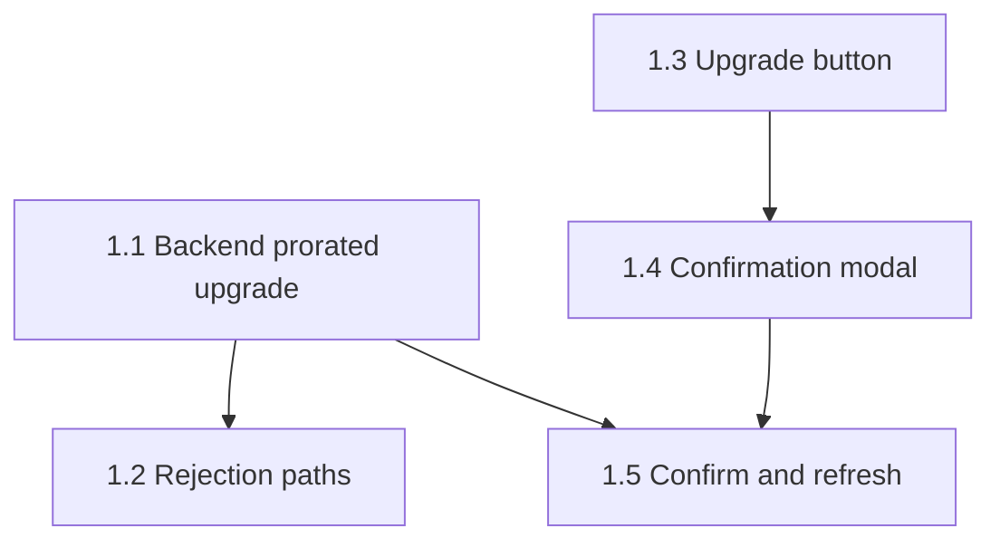

# aire State Tracking

## Project Information
- **Project Type**: Brownfield
- **Start Date**: 2026-10-14T10:32:49Z
- **Current Stage**: IMPLEMENTATION - Design complete - awaiting dev-implement
- **AIRE Version**: 1.0

## Workspace State
- **Existing Code**: Yes
- **Programming Languages**: Python (FastAPI backend), JavaScript/React (Vite frontend)
- **Build System**: pip (requirements.txt), npm/Vite
- **Project Structure**: Monolith POC (src/backend + src/frontend), in-memory data
- **Reverse Engineering Needed**: No (Atlas deep dive pulled)
- **Reverse Engineering Artifacts**: spec/plans/atlas-deep-dive.md
- **Workspace Root**: /Users/argneshu.gupta/demo-ott-billing

## Code Location Rules
- **Application Code**: src/ (NEVER in spec/)
- **Documentation**: spec/ only

## Tracker
- Type: LOCAL
- Parent Epic: Self-Serve Premium Upgrade (local; Atlas epic doc 6225)
- Epic URL: —
- Project Key / Repo / Org: —

## Helix MCP Binding
- **Server**: helix (https://helix-mcp.3pillarglobal.com)
- **Docs tool(s)**: get_solution_document_tool, list_solution_documents_tool - fetch Atlas solution documents (deep dive, epic, story)
- **Graph/Search tool(s)**: codebase_cypher_query, codebase_agent_query, graph_change_impact - targeted queries
- **Estate / workspace id**: solution 1102 (demo-ott-billing), last ingested commit 8ab6a581622d24dade36e7490cae6e9f44cf5239
- **Resolved**: 2026-10-14T10:32:49Z

## Branching
- Base Branch: main
- Epic Branch: epic/self-serve-premium-upgrade
- Epic PR: (not raised - raised manually at cycle end via pr-generator)

## Context Project
- **Existing Knowledge**: No
- **Existing Knowledge Path(s)**: —
- **New References**: No
- **New Reference Path(s)**: —

## Extension Configuration
| Extension | Enabled | Decided At |
|---|---|---|
| Security Baseline | Yes | Always mandatory |
| Playwright Test Automation | Yes | Always mandatory |
| Resiliency Baseline | No | Requirements Analysis |
| Property-Based Testing | Yes (full) | Requirements Analysis |

## Stage Progress
### PLANNING PHASE
- [x] Workspace Detection
- [x] Reverse Engineering (skipped - Atlas deep dive pulled verbatim, doc 6025 v26)
- [x] Requirements Analysis (approved 2026-10-14T10:43:14Z)
- [ ] User Stories (GATE 1 approved 2026-10-14T10:50:08Z; stories local, Tracker ID LOCAL)
- [x] Dependency Graph (auto-generated 2026-10-14T10:50:08Z)
- [x] Workflow Planning (auto-announced 2026-10-14T10:50:55Z)
- [ ] Application Design - SKIP
### IMPLEMENTATION PHASE
- [x] Functional Design (approved 2026-10-14T10:54:38Z)
- [x] NFR Requirements (approved 2026-10-14T10:57:34Z)
- [x] NFR Design - SKIPPED
- [x] Infrastructure Design - SKIPPED
- [x] Behaviour Specs & Test Plans (approved 2026-10-14T11:04:21Z)
- [ ] Code Generation - EXECUTE (per story, dev-implement)

## User Stories Settings
- team_size: 2
- story_creation_mode: all-at-once
- target_story_count: 5

## Story Tracker
| Story | Title | Requires | Tracker ID | Status | PR | Merged | Start | End | Recorded |
|-------|-------|----------|------------|--------|----|--------|-------|-----|----------|
| 1.1 | Backend prorated upgrade to Premium | none | LOCAL | Ready for Development | — | — | | | 2026-10-14T10:50:08Z |
| 1.2 | Upgrade request rejection paths | 1.1 | LOCAL | Ready for Development | — | — | | | 2026-10-14T10:50:08Z |
| 1.3 | Upgrade button for Standard users | none | LOCAL | Ready for Development | — | — | | | 2026-10-14T10:50:08Z |
| 1.4 | Upgrade confirmation modal with prorated preview | 1.3 | LOCAL | Ready for Development | — | — | | | 2026-10-14T10:50:08Z |
| 1.5 | Confirm upgrade and refresh Billing page | 1.1, 1.4 | LOCAL | Ready for Development | — | — | | | 2026-10-14T10:50:08Z |

## Dependency Graph

- Immediately startable: 1.1, 1.3 (independent lanes: backend and UI)
- Blocked: 1.2 (by 1.1), 1.4 (by 1.3), 1.5 (by 1.1 and 1.4)
- Shared files: src/backend/main.py (1.1, 1.2); src/frontend/src/pages/Billing.jsx and src/frontend/src/App.css (1.3, 1.4, 1.5)

## CI/CD Configuration
- **Enabled**: No
- **Source**: user opt-out
- **Recorded**: 2026-10-14T10:58:59Z

## Behaviour Specs & Test Plans
- **Work units covered**: 5
- **Behaviour contracts**: spec/behavior/ - 5 file(s), 23 scenarios (plus spec/behavior.feature, 4 cross-story journeys)
- **Manual test plans**: spec/test-plans/ - 5 folder(s), 38 test cases
- **AC coverage**: 23/23 (scenarios) | 23/23 (test cases)
- **Approved**: 2026-10-14T11:04:21Z

## Architecture
- architecture.md v1.0.0 written 2026-10-14T11:01:41Z; 6 verifiable constraints (weights sum 1.0)
- tests/.evals/rubrics/architecture-rubric.json v1.0.0 (6 criteria), security-rubric.json v1.0.0 (8 OWASP criteria), tests/.evals/config.json created

## Requirements Coverage Verification
- Requirements coverage verified post-design: 17/17 applicable REQ-IDs - 2026-10-14T11:04:21Z (no design artifact contradicted a story AC)
