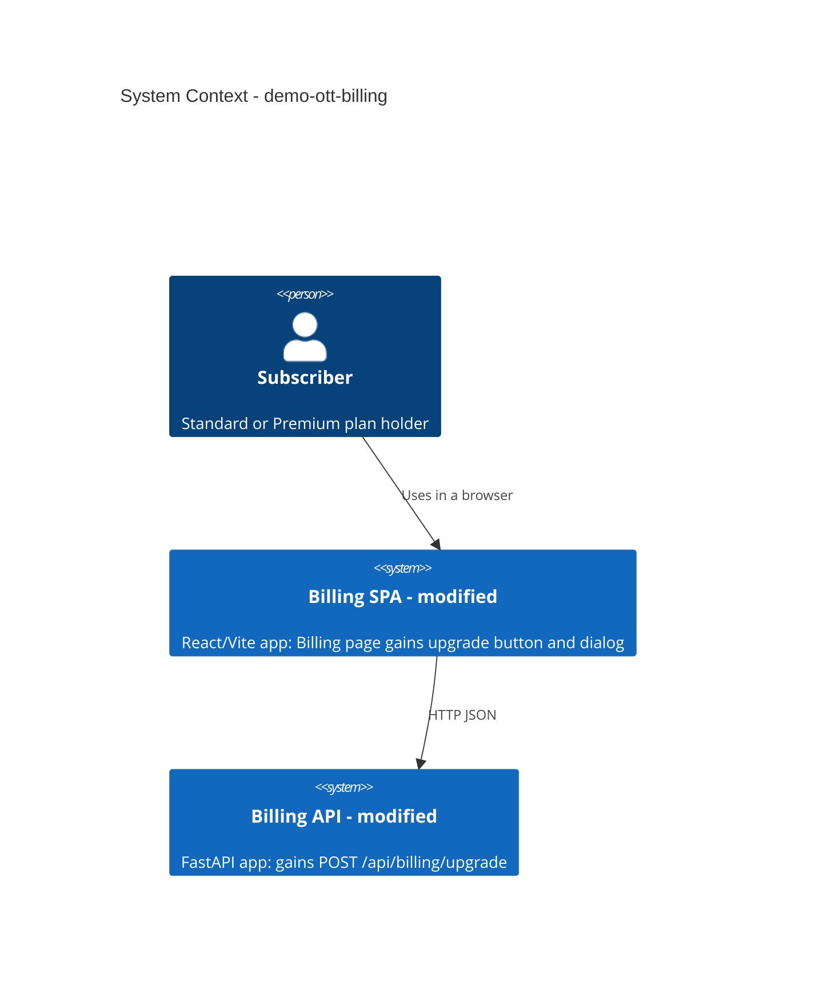
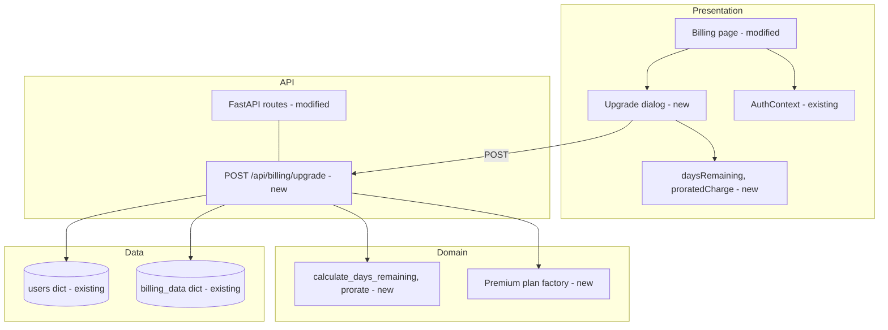
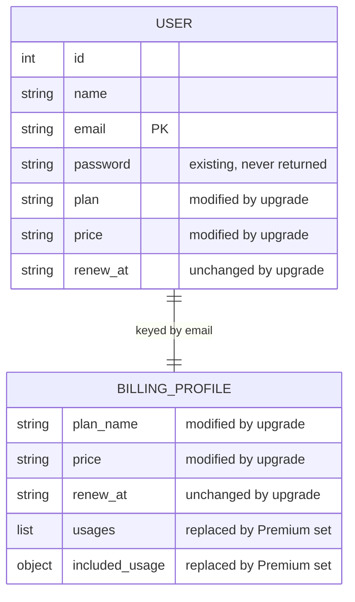
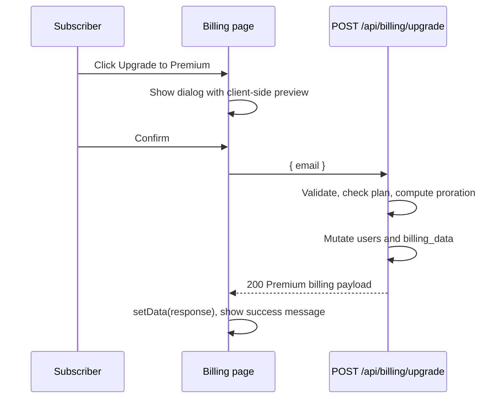

# Architecture - demo-ott-billing (StreamPlex Billing)

> **Version**: 1.0.0 | **Generated**: 2026-10-14T10:59:53Z | **AIRE**: v1.0
> **Derived from**: spec/plans/atlas-deep-dive.md, spec/plans/functional-design.md, spec/plans/nfr.md, spec/plans/requirements.md. Application Design, NFR Design and Infrastructure Design were skipped (see executions.md).
> **Existing-system baseline**: Atlas via Helix MCP, solution 1102 (demo-ott-billing), deep dive doc 6025 v26, ingested commit 8ab6a581622d24dade36e7490cae6e9f44cf5239

## 1. System Context
StreamPlex subscribers use a browser SPA to sign in and view their plan and usage. The SPA calls a FastAPI backend that keeps all users and billing data in process memory. This epic adds one backend endpoint and the upgrade UI. No external systems are called.

## 2. Component Inventory
| Component | Responsibility | Status | Source |
|---|---|---|---|
| Billing page (`Billing.jsx`) | Renders plan and usage; upgrade button, dialog, success message | existing (modified) | atlas-deep-dive.md |
| Upgrade dialog (in `Billing.jsx`) | Prorated preview, Confirm and Cancel, inline error | new | functional-design.md |
| `daysRemaining` / `proratedCharge` (frontend helpers) | Client-side preview of the charge | new | functional-design.md |
| AuthContext | Supplies the token (email) | existing (unchanged) | atlas-deep-dive.md |
| `main.py` routes | Login, register, users/me, billing, and the new `POST /api/billing/upgrade` | existing (modified) | atlas-deep-dive.md |
| `calculate_days_remaining` / `prorate` (backend helpers) | Authoritative proration, date injectable | new | functional-design.md |
| Premium plan catalogue | Premium usage payload factory (deep copy per user) | new | functional-design.md |
| `users`, `billing_data` dicts | In-memory data stores | existing (mutated by upgrade) | atlas-deep-dive.md |

## 3. Layering and Boundaries
- Frontend: the Billing page owns state; helpers are pure functions; only the dialog's Confirm handler calls the upgrade endpoint, and the UI updates only from that response.
- Backend: route handlers validate input and orchestrate; proration and the Premium payload live in separate small functions; only the handler mutates `users` and `billing_data`, and only after every check and calculation succeeded.
- Forbidden: proration formulas inline in a route handler or in JSX; writes to `renew_at`; sharing one mutable Premium payload object between users.

## 4. Data Architecture
In-memory only (no persistence). The upgrade changes `users[email].plan/price` and replaces the plan fields of `billing_data[email]`.

## 5. API and Integration Contracts
`POST /api/billing/upgrade`, body `{ "email": string }` (non-empty). 200 returns `{plan_name, price, renew_at, prorated_charge, usages, included_usage}`; 400 `{"detail":"Already on Premium plan"}`; 401 `{"detail":"Not authenticated"}`; 422 on a malformed body; 500 generic on unexpected failure. Auth model is the existing POC one (email as token); this endpoint performs no token check (accepted deviation REQ-NF-01). Existing endpoints are unchanged.

## 6. Cross-Cutting Decisions
- **AuthN/AuthZ**: POC model unchanged; known deviation recorded (REQ-NF-01); real auth out of scope.
- **Errors**: Pydantic validation (422), explicit 400/401, and a global handler returning a generic 500; fail closed with no partial mutation.
- **Logging**: global handler logs the exception and request path; never passwords, tokens or request bodies.
- **Config/secrets**: none added.
- **Concurrency/idempotency**: single process; a second upgrade of the same user is rejected (400), so the transition is idempotent in effect.

## 7. Non-Functional Targets
| Concern | Target | Source | How it is verified |
|---|---|---|---|
| Unit coverage of changed files | `unitTestCoverageMin` in tests/.evals/config.json | nfr.md | pytest-cov and Vitest coverage |
| Proration correctness | properties hold for all integer days and any date string | functional-design.md | Hypothesis |
| Accessibility of dialog | labelled dialog, focus management, Escape closes | nfr.md | Playwright |
| Performance/scalability/availability | N/A (in-memory POC) | nfr.md | not applicable |

## 8. Infrastructure and Deployment
Unchanged: one Uvicorn process serving the API (and the built SPA when `dist/` exists), Vite dev server in development. No new infrastructure.

## 9. Delta from the Existing System
| Area | Before (Atlas) | After | Reason |
|---|---|---|---|
| Billing page | read-only | upgrade button, dialog, success message | epic goal |
| Backend API | login, register, me, billing | plus `POST /api/billing/upgrade` | epic goal |
| Plan data | Standard only | Premium payload factory | REQ-F-06 |
| Tests | none | pytest, Hypothesis, Vitest, Playwright | REQ-NF-02, REQ-NF-03 |

## 10. Verifiable Constraints

### ARCH-01 - Validate, then mutate
- **Constraint**: The upgrade handler changes `users` and `billing_data` only after every check (user exists, plan is Standard) and every calculation has succeeded.
- **Verifiable as**: In the changed upgrade handler, no assignment to `users[...]` or `billing_data[...]` appears before the checks that can raise and before the proration is computed. Score 0 if any write precedes a check or calculation that can fail.
- **Weight**: 0.25
- **Source**: spec/plans/functional-design.md (BR-5)

### ARCH-02 - Proration in separate pure functions
- **Constraint**: Days-remaining and prorated-charge logic live in their own functions that take today's date as an input, on both backend and frontend.
- **Verifiable as**: The formula `(40 - 20) * days / 30` (or equivalent constants) must not appear inline inside a route handler or a JSX component body, and the day calculation must not call the current date internally without an injectable parameter. Score 0 on either.
- **Weight**: 0.20
- **Source**: spec/plans/functional-design.md (Sections 2 and 4), spec/plans/nfr.md (Maintainability)

### ARCH-03 - No shared mutable Premium payload
- **Constraint**: Each upgraded user receives their own copy of the Premium usages and included_usage.
- **Verifiable as**: A module-level Premium dict or list must not be assigned directly into `billing_data[...]`; it must be built by a factory or deep-copied. Score 0 if one object can be referenced by two users.
- **Weight**: 0.15
- **Source**: spec/plans/functional-design.md (Section 1, BR-7)

### ARCH-04 - Renewal date is read-only
- **Constraint**: No upgrade code path writes `renew_at` in the backend or fabricates a new one in the frontend.
- **Verifiable as**: No assignment to `renew_at` (backend dict key or frontend state) in the changed upgrade code other than carrying the value from the existing record or the server response. Score 0 on any write or recomputation.
- **Weight**: 0.10
- **Source**: spec/plans/functional-design.md (BR-4), spec/plans/requirements.md (REQ-F-09)

### ARCH-05 - No secrets in responses or logs
- **Constraint**: Upgrade responses and log statements never include the password, a token or the raw request body.
- **Verifiable as**: The upgrade response must not be built from a full `users[email]` record without removing `password`, and no changed log call may pass the password, the token or the request body. Score 0 on any occurrence.
- **Weight**: 0.15
- **Source**: spec/plans/nfr.md (Security, SECURITY-03 and SECURITY-11)

### ARCH-06 - UI state comes from the server response
- **Constraint**: After a confirmed upgrade the page state is set from the backend response, with no locally fabricated plan data and no full page reload.
- **Verifiable as**: In the changed Billing page code, plan name, price, usages and renewal date after Confirm come from the response passed to `setData`; no `window.location.reload`, `location.href =` or hard-coded Premium plan object is used to update the page. Score 0 on any of these.
- **Weight**: 0.15
- **Source**: spec/plans/requirements.md (REQ-F-07), spec/plans/functional-design.md (Section 4)

## 11. Explicitly Out of Scope
Persistent storage, real authentication or authorization, payment processing, refunds, downgrades, additional plans, security headers and CORS hardening (pre-existing findings), horizontal scaling, and any infrastructure or deployment change.
