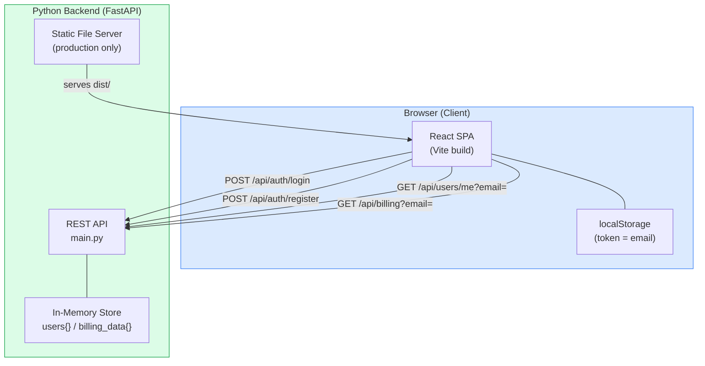
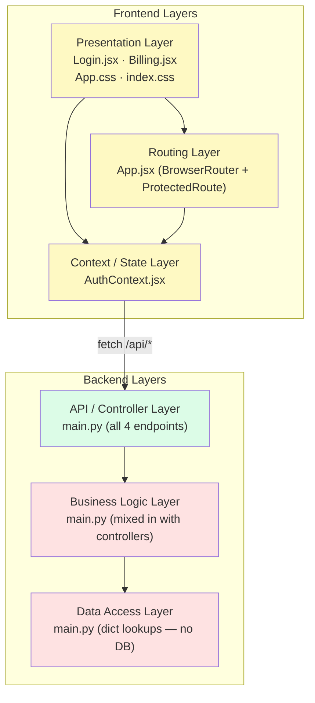
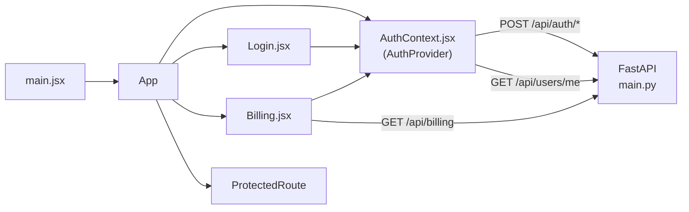
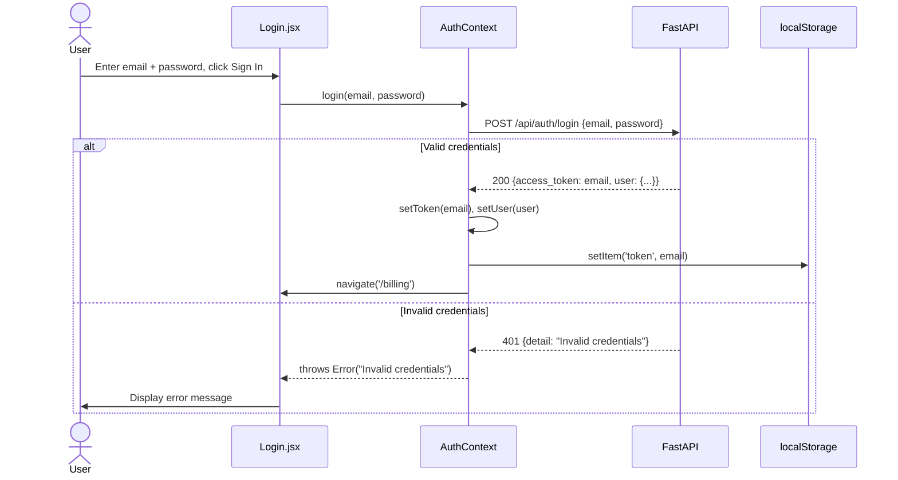
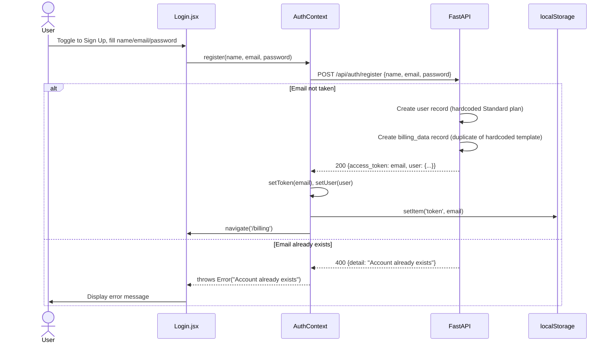
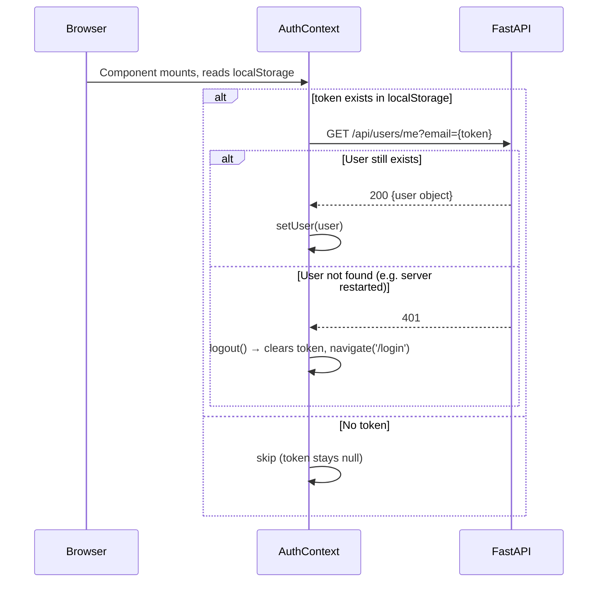
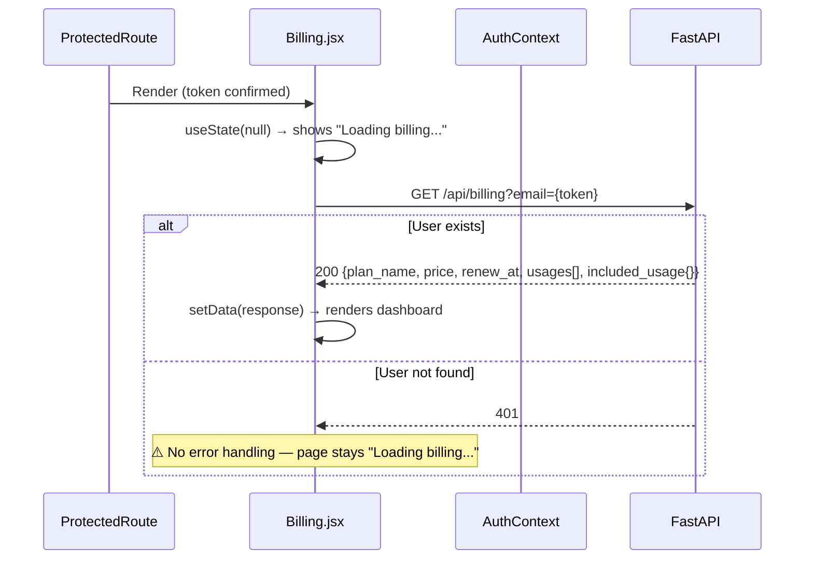
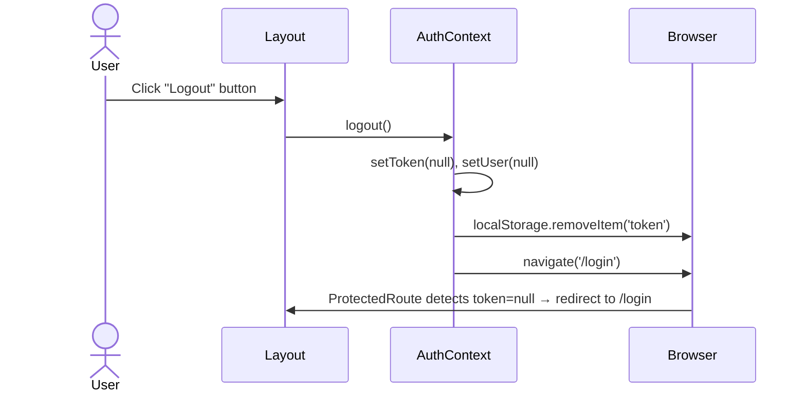
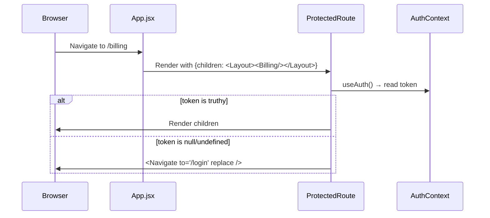
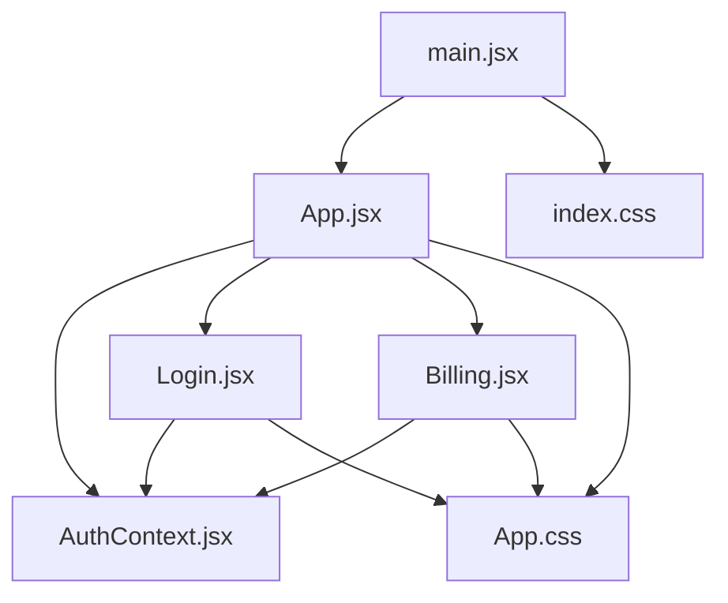

<!--
Provenance: Atlas deep dive (pulled verbatim via Helix MCP, read-only input)
Source: Helix MCP / Atlas solution document id 6025, version 26, "Deep Dive: OTT Billing.md"
Solution: demo-ott-billing (id 1102), last ingested commit 8ab6a581622d24dade36e7490cae6e9f44cf5239
Pulled: 2026-10-14T10:32:06Z
-->

# Deep Dive Analysis: OTT Billing

**Created:** 2026-10-09
**For:** Argneshu
**Analysis Depth:** Exhaustive
**Status:** COMPLETE
**Steps Completed:** 13 of 13

> **Purpose:** Exhaustive system analysis covering architecture, flows, dependencies, code quality, testing, security, performance, and documentation with prioritized strategic recommendations.
> **Scope:** `src/` folder only (frontend + backend source code)
> **Analysis Focus:** All areas within scope
> **Code Quality Analysis:** Included
> **Security Analysis:** Included

---

## Executive Summary

### System Overview

**OTT Billing** (branded internally as "StreamPlex") is a proof-of-concept full-stack web application for an OTT (Over-The-Top) streaming subscription billing management system. It consists of a **Python FastAPI backend** (single file, 163 LOC) and a **React 19 + Vite frontend** (5 JSX files, ~436 LOC + 611 LOC CSS). The system allows users to register, log in, and view their subscription plan and billing details.

The backend serves 4 REST API endpoints covering authentication (login/register) and data retrieval (user profile, billing). All data is stored in-memory via Python dictionaries with a single pre-seeded demo user (`tpg@example.com`). In production, the FastAPI process statically serves the compiled React frontend from `src/frontend/dist/`. During development, Vite's dev server proxies `/api/*` calls to the FastAPI backend.

This codebase is clearly a **POC/demo** — intentionally minimal, with no real authentication, no database, no tests, and multiple security patterns that are inappropriate for production. The core value is demonstrating the billing UI and API contract. Significant investment is required to bring this to production readiness across security, persistence, testing, and architecture.

### Complexity Assessment

- **Overall Complexity:** Low (POC scale — ~1,200 LOC total across both tiers)
- **Lines of Code:** ~1,223 (163 Python + ~436 JSX + 611 CSS + 13 HTML)
- **Components:** 11 backend components + 12 frontend components = 23 total
- **Dependencies:** 3 Python (unpinned) + 8 NPM packages
- **Technical Debt:** **High** — multiple critical security issues, zero tests, no persistence, monolithic structure

### Top 10 Critical Findings

1. **[Security - Critical] Email used as auth token:** The `access_token` returned by login/register is literally the user's email string — no JWT, no cryptographic signing, no expiry. Any user can impersonate another by knowing their email.
2. **[Security - Critical] Plaintext password storage:** All passwords stored as raw strings in an in-memory Python dict. No hashing (bcrypt, argon2) of any kind.
3. **[Security - Critical] IDOR on billing/profile endpoints:** `GET /api/billing?email=X` and `GET /api/users/me?email=X` accept any email without ownership verification — any authenticated user can access any other user's data.
4. **[Security - Critical] No persistence layer:** All users and billing data live in Python process memory. A server restart wipes all registered accounts, making the system unreliable even for demo use.
5. **[Security - Critical] Hardcoded credentials in source code:** Demo user `tpg@example.com` / `password` is hardcoded in `main.py`, and the same email/password are pre-filled as default form values in `Login.jsx`.
6. **[Testing - Critical] Zero test coverage:** No unit, integration, or E2E tests exist anywhere in `src/`. The application has no test framework configured.
7. **[Security - High] Wildcard CORS:** `allow_origins=["*"]` combined with `allow_credentials=True` is a security misconfiguration — must be restricted to known origins.
8. **[Code Quality - High] Silent failure on billing fetch:** `Billing.jsx` has no `.catch()` on its fetch — API errors leave the UI permanently stuck on "Loading billing..." with no user feedback.
9. **[Architecture - Medium] Monolithic backend file:** All routes, models, data stores, and static file serving live in one 163 LOC `main.py` — no separation of concerns, making testing and scaling impossible.
10. **[Documentation - High] Missing application documentation:** The README covers the AIRE workflow framework, not the OTT billing app. No developer onboarding guide, no API docs, no architecture docs exist for the application itself.

### Risk Assessment

| Risk Category | Level | Impact | Mitigation Priority |
|---------------|-------|--------|---------------------|
| Security | 🔴 H | Multiple critical vulnerabilities — not safe for production or public access in current state | **Immediate** |
| Technical Debt | 🔴 H | No tests, no persistence, monolithic files — high regression risk and scaling cost | **Next Sprint** |
| Scalability | 🔴 H | In-memory store prevents horizontal scaling; any second server instance breaks auth | **Next Quarter** |
| Maintainability | 🟡 M | Small codebase is readable now; monolithic CSS and backend will degrade quickly as features are added | **Next Quarter** |
| Documentation | 🟡 M | Missing developer onboarding docs blocks any new team member from contributing effectively | **Next Sprint** |

---

## Comprehensive Reconnaissance

### Directory Structure

```
demo-ott-billing/src/
├── backend/
│   ├── main.py                  ← Single-file FastAPI app (163 LOC)
│   └── requirements.txt         ← 3 dependencies
└── frontend/
    ├── index.html               ← SPA entry point
    ├── vite.config.js           ← Build config + dev proxy
    ├── package.json             ← NPM manifest
    ├── .oxlintrc.json           ← Linter config
    └── src/
        ├── main.jsx             ← React bootstrap (10 LOC)
        ├── App.jsx              ← Router + layout + auth guard (62 LOC)
        ├── App.css              ← All component styles (~579 LOC)
        ├── index.css            ← Global resets (32 LOC)
        ├── context/
        │   └── AuthContext.jsx  ← Auth state + API calls (66 LOC)
        ├── pages/
        │   ├── Login.jsx        ← Login/Register form (135 LOC)
        │   └── Billing.jsx      ← Billing dashboard (163 LOC)
        └── assets/
            ├── hero.png
            ├── react.svg
            └── vite.svg
```

### Technology Stack

**Programming Languages:**

| Language | Files | Lines of Code | Percentage |
|----------|-------|---------------|------------|
| Python | 1 | 163 | ~14% |
| JSX (React) | 5 | 436 | ~38% |
| CSS | 2 | 611 | ~53% |
| HTML | 1 | 13 | ~1% |

**Frameworks & Libraries:**

| Framework | Version | Purpose | Status |
|-----------|---------|---------|--------|
| FastAPI | unversioned (latest) | Backend REST API | Current |
| Uvicorn | unversioned (standard extras) | ASGI server | Current |
| python-multipart | unversioned | Form data parsing | Current |
| React | ^19.2.8 | Frontend UI library | Current (very new) |
| React DOM | ^19.2.8 | React renderer | Current |
| React Router DOM | ^7.18.2 | Client-side routing | Current |
| Vite | ^8.2.2 | Frontend build tool | Current |
| @vitejs/plugin-react | ^6.1.0 | Vite React integration | Current |
| oxlint | ^1.79.0 | JavaScript linter | Current |
| Pydantic | (bundled with FastAPI) | Request validation | Current |

**Build & Tooling:**

- **Build System:** Vite 8.x
- **Package Manager:** NPM (frontend); pip (backend)
- **Testing Framework:** None detected
- **Linter:** oxlint (frontend only)
- **CI/CD:** None in `src/` (AIRE workflow tooling exists outside scope)
- **Dev Proxy:** Vite proxies `/api/*` → `http://localhost:8000`

### Comprehensive Statistics

| Metric | Value |
|--------|-------|
| Total Files (src/ only) | 13 source files |
| Total LOC | ~1,223 |
| Code Files | 8 (1 Python + 5 JSX + 2 CSS) |
| Test Files | 0 |
| Config Files | 3 (vite.config.js, package.json, requirements.txt) |
| Documentation Files | 1 (frontend/README.md) |
| Average File Size | ~94 LOC |
| Largest File | App.css (579 LOC) |
| Code-to-Comment Ratio | ~50:1 (minimal inline comments) |

### Entry Points

**Application Entry Points:**

- `src/frontend/src/main.jsx` - React SPA bootstrap, mounts `<App>` into `#root`
- `src/backend/main.py` - FastAPI app root; starts with `uvicorn main:app`

**API Endpoints:** 4 endpoints in a single router file (`main.py`)

| Method | Path | Purpose |
|--------|------|---------|
| POST | `/api/auth/login` | Authenticate user, return token + user |
| POST | `/api/auth/register` | Register new user, return token + user |
| GET | `/api/users/me?email=` | Fetch current user profile |
| GET | `/api/billing?email=` | Fetch billing data for user |

**Static File Serving:** In production, FastAPI serves the built frontend from `../frontend/dist`

**CLI Interfaces:** None

**Background Jobs:** None

**Scheduled Tasks:** None

---

## Deep Architectural Analysis

### Architectural Style & Patterns

**Primary Style:** **Monolith with SPA frontend + REST backend** — a classic two-tier web application. The backend is a single-file FastAPI monolith (`main.py`) handling all concerns (auth, data, static serving). The frontend is a React SPA with client-side routing. In production, the backend statically serves the compiled frontend, making deployment a single process.

**Evidence:**
- Single backend file (`main.py`, 163 LOC) with all routes, models, and in-memory data
- Frontend is a standalone Vite/React SPA with its own build pipeline
- No separation into services, modules, or packages on either side
- Vite dev proxy unifies API and frontend under one origin during development

**Secondary Patterns Detected:**

- **Context Provider Pattern (React):** `AuthContext.jsx` uses React Context + Provider to propagate auth state (`user`, `token`, `login`, `register`, `logout`) down the component tree without prop-drilling. Consistently applied.
- **Protected Route Pattern:** `ProtectedRoute` component in `App.jsx` wraps authenticated routes — redirects unauthenticated users to `/login`. Clean implementation.
- **Layout Component Pattern:** `Layout` component in `App.jsx` wraps the authenticated shell (header, nav, user pill) around page content — good separation of shell from page.
- **Data-Fetch-on-Mount Pattern:** `Billing.jsx` uses `useEffect` + `fetch` to load billing data. `AuthContext` uses `useEffect` to restore session on page load. No caching layer.
- **Token-as-Email Anti-Pattern (critical):** The backend uses the user's **email address as the auth token** — the `access_token` returned is literally the email string. This is passed as a plaintext query param (`?email=`) on all GET requests.

**Anti-Patterns Detected:**

| Anti-Pattern | Location | Impact |
|---|---|---|
| **Email-as-Token** | `main.py` login/register, `AuthContext.jsx` | Critical security flaw — not a real auth token; no expiry, no invalidation, trivially guessable |
| **Plaintext credential in URL** | `Billing.jsx` L81, `AuthContext.jsx` L13 | Token (email) sent as GET query param — appears in server logs, browser history, referrer headers |
| **Passwords stored in plaintext** | `main.py` `users` dict | No hashing (bcrypt, argon2, etc.) — all passwords stored as plain strings in memory |
| **Wildcard CORS** | `main.py` L11-16 (`allow_origins=["*"]`) | Any origin can make credentialed requests to the API |
| **No input validation beyond types** | `main.py` Pydantic models | No email format validation, no password length/complexity rules |
| **Hardcoded test credentials** | `Login.jsx` L8-9 | Default email/password pre-filled in the login form (`tpg@example.com` / `password`) |
| **All styles in one file** | `App.css` (579 LOC) | Monolithic CSS; all component styles colocated — poor scalability |
| **Business logic in API layer** | `main.py` | Registration creates billing records inline; plan assignment hardcoded |
| **In-memory data store** | `main.py` `users`, `billing_data` | No persistence — all data lost on server restart |

### Architecture Diagrams

#### High-Level System Architecture



#### Layer Diagram



#### Module Interaction Diagram



### Complete Component Catalog

#### Backend Components

| Component | Path | Responsibility | Complexity | Issues |
|---|---|---|---|---|
| **FastAPI App** | `src/backend/main.py:8` | App root, CORS middleware, static serving | Simple | Wildcard CORS |
| **In-Memory User Store** | `main.py:19-29` | Stores all user records | Simple | No persistence, plaintext passwords |
| **In-Memory Billing Store** | `main.py:31-68` | Stores billing + usage data per user | Simple | No persistence, hardcoded plan data |
| **LoginRequest model** | `main.py:70-72` | Pydantic model for login payload | Simple | No email/password validation |
| **RegisterRequest model** | `main.py:75-78` | Pydantic model for registration | Simple | No validation constraints |
| **TokenRequest model** | `main.py:81-83` | Pydantic model (unused in routes) | Simple | Dead code |
| **`/api/auth/login`** | `main.py:85-90` | Authenticate + return token | Simple | Email IS the token |
| **`/api/auth/register`** | `main.py:93-142` | Register user + create billing record | Medium | Hardcoded plan assignment, duplicate billing data |
| **`/api/users/me`** | `main.py:145-150` | Return user profile | Simple | Auth via query param |
| **`/api/billing`** | `main.py:153-157` | Return billing data | Simple | Auth via query param |
| **Static File Mount** | `main.py:160-163` | Serve built frontend in production | Simple | Conditional on dist/ existing |

#### Frontend Components

| Component | Path | Responsibility | Complexity | Issues |
|---|---|---|---|---|
| **`main.jsx`** | `src/frontend/src/main.jsx` | React DOM bootstrap in StrictMode | Simple | None |
| **`App.jsx`** | `src/frontend/src/App.jsx` | Router, Layout shell, ProtectedRoute | Simple | Route `/` and `/login` both render Login (duplicate) |
| **`Layout`** | `App.jsx:7-32` | Authenticated page shell with header/nav | Simple | None |
| **`ProtectedRoute`** | `App.jsx:34-37` | Auth guard — redirects unauthenticated users | Simple | None |
| **`AuthContext`** | `src/frontend/src/context/AuthContext.jsx` | Global auth state, login/register/logout, session restore | Medium | Token = email string; stored in localStorage |
| **`Login.jsx`** | `src/frontend/src/pages/Login.jsx` | Dual login/register form with toggle | Simple | Hardcoded test credentials in state defaults |
| **`Billing.jsx`** | `src/frontend/src/pages/Billing.jsx` | Billing dashboard, plan details, usage cards | Medium | No error handling on failed fetch; token sent as URL param |
| **`InfoIcon`** | `Billing.jsx:5-21` | Inline SVG info icon | Simple | Could be a shared component |
| **`UsageIcon`** | `Billing.jsx:23-50` | Icon switcher by usage ID | Simple | Switch logic tightly coupled to data IDs |
| **`IncludedUsageCard`** | `Billing.jsx:52-74` | Renders plan perk usage bars | Simple | None |
| **`App.css`** | `src/frontend/src/App.css` | All component + page styles (579 LOC) | Medium | Monolithic; no CSS modules or scoping |
| **`index.css`** | `src/frontend/src/index.css` | Global resets and base styles | Simple | None |

### Architectural Assessment

**Strengths:**

- Clean React Context pattern — auth state is well-encapsulated in `AuthContext` and consistently consumed via `useAuth()`
- Good route protection — `ProtectedRoute` pattern is clean and works correctly
- Layout/page separation — `Layout` wraps the shell, pages own their content
- Small, focused components — each JSX file has a clear single responsibility
- Vite dev proxy — cleanly unifies API and SPA under one origin in development

**Weaknesses:**

- **No real authentication** — the "token" is just the user's email; there is no JWT, session management, or token expiry
- **No persistence layer** — all data lives in Python dicts; every server restart wipes all registered users
- **Zero test coverage** — no unit, integration, or E2E tests anywhere in `src/`
- **Monolithic CSS** — 579 LOC in a single `App.css` file; will become unmaintainable as the app grows
- **Backend is a single file** — no separation of routes, models, services, or data access; will not scale
- **Duplicate route** — both `/` and `/login` render `<Login />`, creating a confusing URL structure

**Recommendations:**

- Replace email-as-token with proper JWT authentication (e.g., `python-jose` + `passlib`)
- Add a real database (SQLite for dev, PostgreSQL for production) with SQLAlchemy or SQLModel
- Split `main.py` into routers (`auth.py`, `billing.py`), models, and a services layer
- Migrate to CSS Modules or a utility-first framework (Tailwind) to scope styles
- Add password hashing (bcrypt via `passlib`)
- Restrict CORS origins to known frontend origins

---

## Comprehensive Flow Analysis

**Flows Identified:** 6 total across 4 categories | **Background Jobs:** None | **Data Pipelines:** None | **Integrations:** None (self-contained)

---

### Flow 1: Login Flow

**Purpose:** Authenticate an existing user and establish a client-side session.



**Decision Points:** Password comparison is plaintext string equality (`user["password"] != payload.password`).
**Error Handling:** 401 is caught in `AuthContext`, re-thrown, caught in `Login.jsx`, displayed as `error` state.
**Edge Cases:** No rate limiting; no lockout after failed attempts; email case-sensitivity depends on dict key.

---

### Flow 2: Registration Flow

**Purpose:** Create a new user account with a default Standard plan and redirect to billing.



**Decision Points:** Duplicate email check via `payload.email in users` dict.
**Error Handling:** 400 caught and surfaced to user.
**Issues:** Billing data is copy-pasted inline (not from a shared template/function). Plan is always "Standard" — no plan selection at registration.

---

### Flow 3: Session Restore Flow

**Purpose:** Restore authenticated session when user returns or refreshes the page.



**Critical Issue:** Since the backend is in-memory, a server restart clears all users. The token (email) persists in localStorage, but the next session restore call will get a 401 and force logout. No graceful error message is shown.

---

### Flow 4: Billing Data Load Flow

**Purpose:** Fetch and display billing dashboard data for the authenticated user.



**Critical Gap:** The `fetch` chain in `Billing.jsx` has no `.catch()`. A failed request silently leaves the UI stuck on "Loading billing..." with no user feedback.

---

### Flow 5: Logout Flow

**Purpose:** Clear session and redirect to login.



**No server-side session invalidation** — since the token is just an email, there is nothing to invalidate on the backend.

---

### Flow 6: Route Guard Flow

**Purpose:** Enforce authentication on protected pages.



---

### Flow Interactions

| Shared Component | Used By Flows | Consideration |
|---|---|---|
| `AuthContext` | All flows | Single source of truth for token; all API calls derive identity from it |
| `localStorage` | Login, Register, Session Restore, Logout | Token persisted here; only email string, no expiry |
| `FastAPI in-memory store` | Login, Register, Session Restore, Billing | Server restart invalidates all sessions silently |
| `navigate()` | Login, Register, Logout | All navigation is imperative; no declarative guards beyond ProtectedRoute |

**Race Condition Risk:** If `AuthContext` mounts and immediately starts session restore (`GET /api/users/me`) while simultaneously `Billing.jsx` mounts and fires `GET /api/billing`, both use the same token. If the server is slow and the session restore fails, `logout()` runs — but `Billing.jsx` may have already received its data. No observable bug currently, but the ordering is fragile.

**Transaction Boundaries:** None — no database, no transactions. Operations are synchronous dict mutations.

**Concurrency:** Python's GIL + Uvicorn single-worker default means no true concurrency on the backend. Frontend fetch calls are non-blocking but there is no request deduplication or cancellation.

---

## Exhaustive Dependency Analysis

### Internal Dependencies

#### Dependency Graph



#### Coupling Metrics

| Module | Afferent Coupling (Ca) | Efferent Coupling (Ce) | Instability (Ce/Ca+Ce) | Assessment |
|--------|------------------------|------------------------|------------------------|------------|
| `AuthContext.jsx` | 3 (App, Login, Billing) | 1 (react-router/navigate) | 0.25 | **Stable** — core dependency |
| `App.jsx` | 1 (main.jsx) | 4 (AuthContext, Login, Billing, react-router) | 0.8 | **Unstable** — orchestrates everything |
| `App.css` | 3 (App, Login, Billing) | 0 | 0.0 | **Maximally Stable** (no outgoing deps) |
| `Login.jsx` | 1 (App) | 2 (AuthContext, App.css) | 0.67 | Moderately unstable |
| `Billing.jsx` | 1 (App) | 2 (AuthContext, App.css) | 0.67 | Moderately unstable |
| `main.jsx` | 0 | 2 (App, index.css) | 1.0 | **Maximally Unstable** (entry point) |
| `main.py` | 0 | 3 (fastapi, pydantic, pathlib) | 1.0 | Maximally Unstable (entry point) |

#### Circular Dependencies

**None detected.** The dependency graph is a clean DAG (directed acyclic graph). Import flow is strictly top-down: entry points → routing → pages → context.

### External Dependencies

#### Backend (Python)

| Dependency | Declared Version | Purpose | License | Known CVEs | Update Rec |
|------------|-----------------|---------|---------|------------|------------|
| `fastapi` | unversioned (latest) | REST API framework | MIT | None currently | Pin version for reproducibility |
| `uvicorn[standard]` | unversioned (latest) | ASGI server (includes websockets, httptools) | BSD | None currently | Pin version |
| `python-multipart` | unversioned (latest) | Form data body parsing | Apache-2.0 | None currently | Pin version |

⚠️ **All backend dependencies are unpinned.** `requirements.txt` has no version specifiers — `pip install` will always pull the latest. This is a reproducibility and stability risk. A breaking release of any package can break the backend silently.

#### Frontend (NPM)

| Dependency | Declared Version | Purpose | License | Notes |
|------------|-----------------|---------|---------|-------|
| `react` | ^19.2.8 | UI rendering library | MIT | React 19 (very new — released late 2024) |
| `react-dom` | ^19.2.8 | DOM renderer for React | MIT | Paired with React |
| `react-router-dom` | ^7.18.2 | Client-side routing | MIT | React Router v7 (major API changes from v6) |
| `vite` | ^8.2.2 | Build tool + dev server | MIT | Vite 8 (current) |
| `@vitejs/plugin-react` | ^6.1.0 | React Fast Refresh + JSX transform | MIT | Current |
| `oxlint` | ^1.79.0 | Rust-based JS linter | MIT | Fast, modern alternative to ESLint |
| `@types/react` | ^19.2.18 | TypeScript defs for React | MIT | Present but project uses JSX not TSX |
| `@types/react-dom` | ^19.2.4 | TypeScript defs for ReactDOM | MIT | Present but project uses JSX not TSX |

**Frontend Observations:**
- Using React 19 — a very recent major version. Likely stable for a POC but may have undocumented breaking changes.
- TypeScript type packages (`@types/*`) are installed but the project uses plain `.jsx` not `.tsx` — suggests a possible migration intent or copy-paste from a template.
- No testing library (no Jest, Vitest, Testing Library) despite dev dependencies section.

### External Service Integrations

**None.** The system is fully self-contained. All data is held in memory on the FastAPI backend. No external APIs, databases, message queues, payment providers, or third-party services are integrated.

### Database Analysis

**No database.** All persistence is via Python in-memory dictionaries:

| Store | Type | Contents | Persistence | Schema Migration |
|-------|------|----------|-------------|-----------------|
| `users` dict | In-memory Python dict | User records (id, name, email, password, plan, price, renew_at) | ❌ Lost on restart | N/A |
| `billing_data` dict | In-memory Python dict | Per-user billing details (plan, price, renew_at, usages, perks) | ❌ Lost on restart | N/A |

**Pre-seeded Data:** One hardcoded user (`tpg@example.com` / `password`) is seeded at startup. This is clearly a POC/demo pattern.

**Implications for production readiness:**
- Any real deployment requires a persistent database (PostgreSQL, SQLite, etc.)
- Schema design is implicit — the dict structure defines the "schema" informally
- No migration tooling (Alembic, etc.) exists
- No indexes, no transactions, no referential integrity

---

## Code Quality & Technical Debt

**Overall Quality Assessment: Fair** — the codebase is clean and readable at a small scale, but carries fundamental structural debt that would block production use and growth.

### Complexity Metrics

| File | LOC | Cyclomatic Complexity | Assessment |
|------|-----|----------------------|------------|
| `App.css` | 579 | N/A (CSS) | ⚠️ Monolithic — all styles in one file |
| `main.py` | 163 | ~8 (branching across all routes) | Medium — all concerns in one file |
| `Billing.jsx` | 163 | ~5 | Medium — multiple inline components |
| `Login.jsx` | 135 | ~4 | Low-Medium — dual login/signup mode |
| `AuthContext.jsx` | 66 | ~3 | Low — well-focused |
| `App.jsx` | 62 | ~3 | Low — clean router |
| `main.jsx` | 10 | 1 | Minimal |

**No methods exceed 50 LOC** — individual functions are short. Complexity is structural (too many concerns in too few files) rather than algorithmic.

### Code Duplication

**Estimated duplication: ~15-20%** — concentrated in one significant pattern:

**Billing data template duplication (HIGH):** The billing data structure for new users in `register()` (lines 110-141 of `main.py`) is a near-verbatim copy of the hardcoded `billing_data` initializer (lines 31-68). The same 3 usage items and `included_usage` structure are copy-pasted inline.

**Recommendation:** Extract a `get_default_billing_data()` factory function.

### Code Smells Catalog

| Smell | Location | Severity | Description |
|---|---|---|---|
| **God File** | `main.py` | 🔴 High | All routes, models, data stores, and static serving in 163 LOC single file |
| **God File** | `App.css` | 🟡 Medium | 579 LOC of all component styles — login, billing, usage cards, tooltips, layout |
| **Hardcoded Credentials** | `Login.jsx` L8-9 | 🔴 High | Default email `tpg@example.com` and password `password` in component state |
| **Magic Strings** | `main.py` L25-28, 34-36 | 🟡 Medium | Plan name `"Standard"`, price `"$20/month"`, date `"Oct 30, 2026"` hardcoded |
| **Primitive Obsession (token)** | `AuthContext.jsx`, `main.py` | 🔴 High | Using raw email string as an auth token |
| **Dead Code** | `main.py` L81-83 | 🟢 Low | `TokenRequest` Pydantic model declared but never used in any route |
| **Missing Error Handling** | `Billing.jsx` L80-84 | 🔴 High | `fetch()` chain has no `.catch()` — silent failure on API errors |
| **Duplicate Route** | `App.jsx` L44-45 | 🟡 Medium | Both `/` and `/login` render `<Login />` — confusing and redundant |
| **Inline SVG Proliferation** | `Login.jsx`, `Billing.jsx` | 🟢 Low | SVG icons inlined in JSX rather than as shared icon components or a sprite |
| **No Input Sanitization** | `main.py` all endpoints | 🔴 High | No email format validation, no password length check, no XSS-safe handling |
| **Copy-Paste Billing Init** | `main.py` L106-141 | 🟡 Medium | Default billing data duplicated between initialization and register handler |
| **`useAuth()` potential null** | `App.jsx` L8 (Layout) | 🟢 Low | `user?.name?.[0]` optional chaining handles null but context could be undefined if used outside Provider |

### Technical Debt Inventory

#### 🔴 High Priority (Block Production)

| Debt Item | Location | Impact | Effort |
|---|---|---|---|
| No real authentication | `main.py`, `AuthContext.jsx` | Critical — email-as-token is trivially bypassed | Medium |
| Passwords stored in plaintext | `main.py` `users` dict | Critical — any data exposure is catastrophic | Low |
| No persistence layer | `main.py` | Critical — all data lost on restart | High |
| Wildcard CORS | `main.py` L11-16 | High — allows any origin to call the API | Low |
| No error handling on billing fetch | `Billing.jsx` L80-84 | High — silent UI failures | Low |
| Hardcoded test credentials in UI | `Login.jsx` L8-9 | High — credential leakage in source | Low |

#### 🟡 Medium Priority (Impair Maintainability)

| Debt Item | Location | Impact | Effort |
|---|---|---|---|
| Monolithic `main.py` | Backend | Difficult to add features/test in isolation | Medium |
| Monolithic `App.css` | Frontend | Style collisions, poor scaleability | Medium |
| No plan selection at registration | `main.py` register | Limits billing tier flexibility | Medium |
| Duplicate billing data init | `main.py` | Risk of init/register diverging | Low |
| `TokenRequest` dead code | `main.py` L81-83 | Minor confusion | Low |
| Duplicate routes `/` + `/login` | `App.jsx` | UX confusion, unclear canonical URL | Low |

#### 🟢 Low Priority / Acceptable for POC

| Debt Item | Notes |
|---|---|
| Inline SVG icons | Fine for POC; extract to icon lib for scale |
| No TypeScript | Using JSX; type packages installed but unused |
| Vite page title `"frontend"` | `index.html` L7 — should be "StreamPlex" |
| No accessibility (ARIA) | Minimal ARIA attributes on form/buttons |

### TODO / FIXME Inventory

**0 TODO/FIXME/HACK comments found in `src/`.** The codebase has no inline debt markers — all known issues are structural rather than annotated.

---

## Test Coverage Analysis

### Test Suite Overview

| Test Type | Count | % of Suite |
|-----------|-------|------------|
| Unit Tests | 0 | 0% |
| Integration Tests | 0 | 0% |
| End-to-End Tests | 0 | 0% |
| **Total** | **0** | **0%** |

**Test Framework:** None installed. No Jest, Vitest, Pytest, Testing Library, or Playwright detected in `src/`.

**Coverage:** Not measurable — no tests exist and no coverage tooling is configured.

### Coverage by Component

| Component | Coverage | Assessment |
|-----------|----------|------------|
| `main.py` | 0% | 🔴 Critical |
| `AuthContext.jsx` | 0% | 🔴 Critical |
| `App.jsx` | 0% | 🔴 Critical |
| `Login.jsx` | 0% | 🔴 Critical |
| `Billing.jsx` | 0% | 🔴 Critical |

### Testing Gaps

Every component, flow, and edge case is untested. Critical gaps by priority:

1. **Authentication flows** — login, register, session restore, logout — the core of the application. Any regression here would be invisible without tests.
2. **Auth guard (ProtectedRoute)** — unauthenticated access to `/billing` is a security boundary; it has no test.
3. **Billing data fetch + error path** — the silent failure bug in `Billing.jsx` (no `.catch()`) would be caught by any test that simulates a failed fetch.
4. **Backend endpoint validation** — all 4 API endpoints accept any input; no tests verify error responses or boundary conditions.
5. **Session restore on server restart** — the localStorage token survives but the server data does not; this failure mode has no test.
6. **In-memory store state** — tests would reveal that `users` dict is shared global state between requests with no isolation.

### Testing Recommendations

1. **Frontend:** Add Vitest + React Testing Library (matches Vite ecosystem). Start with `AuthContext` unit tests and `ProtectedRoute` behavior tests.
2. **Backend:** Add Pytest + `httpx` (via FastAPI's `TestClient`). Cover all 4 endpoints including error cases (invalid credentials, duplicate email, missing user).
3. **E2E:** Add Playwright for critical user journeys: login → billing view → logout, and register → billing view.
4. **Priority order:** Backend endpoints first (pure functions, easiest to test) → AuthContext → Login/Billing pages → E2E flows.
5. **Coverage target:** Aim for ≥80% on backend, ≥70% on frontend components, 100% on the auth guard logic.

---

## Security Considerations

> ⚠️ **Disclaimer:** This is NOT a security audit. This is a pattern-based review that flags areas requiring professional security assessment before any production deployment.

**Overall Security Posture: Critical** — this system has multiple fundamental security flaws that make it unsuitable for production in its current state.

### Authentication

| Aspect | Finding | Severity |
|---|---|---|
| Token mechanism | Email string used as auth token — no JWT, no session ID | 🔴 Critical |
| Token expiry | No expiry — once logged in, token is valid forever | 🔴 Critical |
| Token storage | Stored in `localStorage` — vulnerable to XSS token theft | 🟡 Medium |
| Token transport | Sent as plaintext query parameter (`?email=`) | 🔴 Critical |
| Password storage | Plaintext in Python dict — no hashing | 🔴 Critical |
| Password policy | No minimum length, no complexity requirements | 🟡 Medium |
| Brute force protection | None — unlimited login attempts | 🔴 Critical |
| Session invalidation | No server-side invalidation on logout | 🟡 Medium |

### Authorization

| Aspect | Finding | Severity |
|---|---|---|
| Access control | Single-level (authenticated = all access) | 🟡 Medium |
| Resource isolation | `GET /api/billing?email=X` accepts any email — any authenticated user can query any other user's billing data by changing the `email` param | 🔴 Critical |
| Role-based access | None | N/A (single role) |

**Critical IDOR (Insecure Direct Object Reference):** The billing and profile endpoints accept `email` as a query parameter with no ownership check. An attacker who knows or guesses another user's email can access their billing data while authenticated with their own account.

### Input Validation

| Aspect | Finding | Severity |
|---|---|---|
| Email format | No validation — any string accepted as email | 🟡 Medium |
| Password constraints | No minimum length, special chars, etc. | 🟡 Medium |
| Name field | No length limit, no sanitization | 🟢 Low (no DB, no injection risk) |
| SQL injection | Not applicable — no database | N/A |
| XSS via input | Low risk — React escapes JSX-rendered values by default | 🟢 Low |

### Output Encoding

React's JSX rendering escapes all user-supplied strings by default — no `dangerouslySetInnerHTML` detected. **XSS risk is low** for currently-rendered content.

### Secret Management

| Aspect | Finding | Severity |
|---|---|---|
| Hardcoded credentials | `tpg@example.com` / `password` seeded in `main.py` | 🔴 Critical |
| Hardcoded credentials in UI | Pre-filled in `Login.jsx` state defaults | 🔴 Critical |
| Environment variables | No `.env` file pattern detected; no config for secrets | 🟡 Medium |
| API secrets | No external API keys — self-contained POC | N/A |

### CORS

```python
CORSMiddleware(allow_origins=["*"], allow_credentials=True, ...)
```

**Wildcard CORS + `allow_credentials=True` is a security misconfiguration.** Browsers block this combination (credentials cannot be sent with wildcard origin in CORS spec), but it signals intent to be maximally permissive. Must be restricted to known origins before production.

### Vulnerability Pattern Summary

| Pattern | Present | Location | Priority |
|---|---|---|---|
| Broken Authentication | ✅ | `main.py`, `AuthContext.jsx` | 🔴 Critical |
| Plaintext Passwords | ✅ | `main.py` user store | 🔴 Critical |
| IDOR | ✅ | `GET /api/billing`, `GET /api/users/me` | 🔴 Critical |
| Token in URL | ✅ | All GET authenticated endpoints | 🔴 Critical |
| Wildcard CORS | ✅ | `main.py` middleware | 🟡 Medium |
| No rate limiting | ✅ | All endpoints | 🔴 Critical |
| Hardcoded secrets | ✅ | `main.py`, `Login.jsx` | 🔴 Critical |
| SQL Injection | ❌ | N/A — no database | N/A |
| XSS | Low risk | React escapes output | 🟢 Low |
| CSRF | ❌ | No state-mutating GETs; POSTs use JSON | 🟢 Low |

### Security Recommendations (Prioritized)

1. **[Critical] Replace email-as-token with JWT** using `python-jose` + proper secret key management
2. **[Critical] Hash passwords** with `passlib[bcrypt]` before storing
3. **[Critical] Add ownership verification** to `/api/billing` and `/api/users/me` — verify `request.user` matches the queried resource
4. **[Critical] Remove hardcoded credentials** from both `main.py` and `Login.jsx`
5. **[High] Add rate limiting** to auth endpoints using `slowapi` or similar
6. **[High] Restrict CORS origins** to the specific frontend domain
7. **[Medium] Move token from URL query param to Authorization header** (`Bearer <token>`)
8. **[Medium] Store JWT in httpOnly cookie** instead of localStorage to prevent XSS token theft

**Professional Security Review: Strongly Recommended** before any production deployment. This codebase has multiple OWASP Top 10 issues (A01 Broken Access Control, A02 Cryptographic Failures, A07 Identification and Authentication Failures).

---

## Performance & Scalability Analysis

### Performance Patterns

**Performance Issues Found: 5**

| Issue | Location | Impact |
|---|---|---|
| **No pagination** | `GET /api/billing` | Returns entire billing object per request; fine now but would need pagination as data grows |
| **No request deduplication** | `AuthContext.jsx` useEffect + `Billing.jsx` useEffect | Both fire on mount; no SWR/React Query to prevent redundant calls |
| **No loading cancellation** | `Billing.jsx` L80-84 | `fetch()` in `useEffect` with no AbortController — stale requests can update state after unmount |
| **In-memory O(1) dict lookups** | `main.py` all endpoints | Currently fast (hash map), but this "performance feature" disappears entirely when switching to a real DB without indexing |
| **No connection pooling** | `main.py` | No database means no connection pooling concern now — but any DB migration must address this |

**No N+1 query patterns detected** — the billing endpoint returns the full nested object in one dict lookup.

**No CPU-intensive operations detected** — all operations are simple dict reads/writes.

### Caching Analysis

| Layer | Current State | Opportunity |
|---|---|---|
| API response caching | None | HTTP cache headers not set; billing data is static per user — could cache aggressively |
| Client-side caching | None (raw `fetch`) | No SWR or React Query — each navigation to Billing.jsx re-fetches |
| In-memory data | The dict IS the "cache" | Data in dict is always fresh (single process); irrelevant once DB is added |
| CDN/static assets | None configured | Production via FastAPI static mount has no CDN layer |

**Cache invalidation strategy:** Not applicable — no caching exists. When a DB is introduced, billing data should be cached at the API response level with cache-busting on plan changes.

### Scalability Considerations

**Horizontal Scaling Readiness: Not Ready**

| Component | Stateful? | Scaling Concern |
|---|---|---|
| FastAPI backend | ✅ Stateful | `users` and `billing_data` dicts are in process memory — two instances cannot share state |
| Frontend SPA | ❌ Stateless | Can be served from CDN with no scaling concerns |
| Auth mechanism | ✅ Stateful | Token = email stored in memory store — no shared session store across instances |

**Bottlenecks:**

1. **Single-process in-memory store** — the primary scaling blocker. Any load balancer distributing traffic across two backend instances would route users to different dicts, breaking auth.
2. **Uvicorn single-worker default** — by default, `uvicorn main:app` runs one worker. Multiple workers require `--workers N` flag, which breaks in-memory state sharing further.
3. **No async DB operations** — when a DB is added, blocking synchronous queries in an async framework (FastAPI) will block the event loop. Must use async ORM (SQLAlchemy async or Tortoise).

### Performance Recommendations

**Quick Wins:**
1. Add `AbortController` to `Billing.jsx` `useEffect` to cancel in-flight requests on unmount
2. Add HTTP cache headers (`Cache-Control: private, max-age=60`) to billing endpoint
3. Use `uvicorn --workers 4` for multi-core utilization (safe only after removing in-memory state)

**Strategic Improvements:**
1. Replace in-memory store with async PostgreSQL + SQLAlchemy (async) — resolves the single scaling bottleneck
2. Introduce SWR or TanStack Query for client-side caching, request deduplication, and stale-while-revalidate
3. Add CDN layer (Cloudflare, AWS CloudFront) for frontend static assets

**Monitoring Recommendations:**
- Track API response times per endpoint (FastAPI middleware or Prometheus)
- Monitor `useEffect` mount/unmount cycles in development with React DevTools Profiler
- Set up health check endpoint (`GET /health`) for load balancer integration

---

## Documentation Audit

### Existing Documentation Assessment

| Document Type | Status | Quality (1-5) | Completeness |
|---------------|--------|---------------|--------------|
| README | ✅ Exists (framework README) | 2/5 | ~20% — covers AIRE workflow framework, not the OTT billing app itself |
| API Documentation | ❌ Missing | — | 0% |
| Architecture Docs | ❌ Missing | — | 0% |
| Setup/Deploy Guide | ⚠️ Partial | 2/5 | ~30% — `frontend/README.md` covers frontend only |
| Troubleshooting | ❌ Missing | — | 0% |
| Runbooks | ❌ Missing | — | 0% |
| Inline Code Comments | ⚠️ Minimal | 2/5 | ~5% — minimal inline comments; 0 TODO/FIXME markers |

**Note:** The `demo-ott-billing/README.md` documents the Helix AIRE workflow framework, not the OTT billing application. A new developer reading the repo README would learn about workflow tooling but nothing about the streaming app they're supposed to be working on.

The `demo-ott-billing/src/frontend/` folder includes a boilerplate Vite+React README that covers only the default setup commands.

### Code Comment Quality

The `src/` codebase has **no meaningful inline comments**. Function names and variable names are generally self-explanatory (e.g., `login`, `register`, `logout`, `billing_data`), so the low comment density is partly acceptable. However:

- The auth security architecture (email-as-token) has no comment explaining this is intentional for POC purposes
- The in-memory store has a comment `# In-memory mock store (no database)` — the only useful comment in the entire backend
- No JSDoc or Python docstrings anywhere

### Critical Knowledge Gaps

1. **How to run the full application** — No document explains how to start both the backend (`uvicorn`) and frontend (`vite`) together, which ports they use, or how they connect in development vs. production.
2. **Authentication design decisions** — The email-as-token pattern is unexplained. A new developer would not know if this is temporary or intentional, or how to evolve it.
3. **Plan data structure** — The billing data schema (plan features, usage items, perk structure) is defined purely in code with no schema documentation. Adding a new plan tier would require reverse-engineering the dict structure.
4. **Production deployment** — No documentation on how the FastAPI static mount for production works, how to build the frontend, or how to combine them.
5. **Hardcoded seed data** — `tpg@example.com` / `password` exists in the production code with no comment explaining its purpose or how to remove it.

### Tribal Knowledge Dependencies

- **"tpg@example.com" user** — The demo user email exists only in code. Only the original developer knows whether this is a test user that should be removed or a required demo account.
- **Plan pricing/features** — The `$20/month` price and Standard plan feature set are hardcoded with no external configuration. Only the developer who originally set these values knows the intent.
- **In-memory vs. DB timeline** — No documentation on whether/when a real database was planned.

### Documentation Priorities

**🔴 Priority 1 — Critical (Blocking Onboarding):**
1. Application-specific README — how to run backend + frontend, ports, development workflow
2. Environment setup guide — prerequisites (Python version, Node version, install commands)
3. API endpoint documentation — what each endpoint does, request/response shapes, auth model

**🟡 Priority 2 — High (Enables Effective Development):**
4. Architecture decision record (ADR) — why email-as-token was chosen and what replaces it
5. Data model documentation — the implicit billing/user schema as an explicit diagram or doc
6. Plan configuration guide — how to add/modify plans and features

**🟢 Priority 3 — Medium (Nice to Have):**
7. Troubleshooting guide — common dev issues (CORS in dev, port conflicts, session loss on restart)
8. Inline docstrings for backend endpoints
9. Component-level JSDoc for React components

---

## Comprehensive Recommendations

### Immediate Actions (Do Now) — 6 items

| # | Action | Severity | Effort | Why It Can't Wait |
|---|--------|----------|--------|-------------------|
| 1 | **Replace email-as-token with JWT** (`python-jose` + `passlib`) | 🔴 Critical | 2-3 days | Any user can forge identity by knowing another's email |
| 2 | **Hash passwords** with `passlib[bcrypt]` before storing | 🔴 Critical | 0.5 days | Plaintext passwords in memory = instant compromise on any exposure |
| 3 | **Fix IDOR on billing/profile endpoints** — verify requesting user owns the resource | 🔴 Critical | 0.5 days | Any authenticated user can read any other user's billing data |
| 4 | **Remove hardcoded credentials** from `Login.jsx` (default email/password in state) | 🔴 Critical | 0.5 hours | Credentials committed to source code are a compliance and trust risk |
| 5 | **Add `.catch()` to Billing.jsx fetch** — show error state on failed API calls | 🔴 High | 1 hour | Silent UI failures confuse users and hide real backend problems |
| 6 | **Restrict CORS origins** from `"*"` to specific frontend URL | 🟡 High | 0.5 hours | Wildcard CORS is a misconfiguration — easy to fix, important for production |

### Short-Term Improvements (Next Sprint) — 5 items

| # | Improvement | Value | Effort |
|---|-------------|-------|--------|
| 1 | **Add application-level README** — how to run frontend + backend, ports, dev workflow | High | 2-4 hours |
| 2 | **Add Pytest + TestClient tests** for all 4 backend endpoints | High | 1-2 days |
| 3 | **Extract `get_default_billing_data()` factory function** — eliminate billing data duplication between init and register | Medium | 1 hour |
| 4 | **Remove `TokenRequest` dead code** from `main.py` | Low | 15 min |
| 5 | **Fix page title** in `index.html` from `"frontend"` to `"StreamPlex"` | Low | 5 min |

### Medium-Term Strategy (Next Quarter) — 5 items

| # | Initiative | Current State | Desired State | Effort |
|---|------------|---------------|---------------|--------|
| 1 | **Add persistence layer** (SQLite dev / PostgreSQL prod) with SQLAlchemy async | In-memory dict — data lost on restart | Persistent DB with schema, migrations (Alembic), and connection pooling | 1-2 weeks |
| 2 | **Split `main.py` into modules** (routers, models, services, db) | 163 LOC monolith | Clean FastAPI project structure with separated concerns | 2-3 days |
| 3 | **Add comprehensive test suite** — Vitest + Testing Library (frontend) + Pytest (backend) | 0% coverage | ≥70% frontend, ≥80% backend, Playwright E2E for key flows | 1-2 weeks |
| 4 | **Migrate to CSS Modules** or Tailwind CSS | 579 LOC monolithic `App.css` | Scoped per-component styles | 2-3 days |
| 5 | **Add plan selection at registration** — remove hardcoded "Standard" plan assignment | All users locked to Standard | Plan picker at sign-up tied to pricing config | 2-3 days |

### Long-Term Evolution (6-12 Months) — 3 items

| # | Evolution | Current Tech | Proposed Tech | Benefit | Effort |
|---|-----------|-------------|---------------|---------|--------|
| 1 | **Migrate to TypeScript** | `.jsx` (no types) | `.tsx` with strict mode | Type safety, better IDE support, fewer runtime errors; type packages already installed | 1-2 weeks |
| 2 | **Add real billing integration** | Hardcoded mock data | Stripe or similar payment provider | Supports actual subscription management, payment processing, invoice generation | 2-4 weeks |
| 3 | **Add observability stack** | No monitoring | Prometheus + Grafana (backend) + Sentry (frontend) | Catch production errors, track performance, monitor SLAs | 1 week |

### Suggested Follow-Up Workflows

- **generate-readme** — Highest priority; create an application-level README for the OTT billing system
- **document-apis** — Generate proper API documentation for the 4 endpoints with auth model, request/response schemas
- **assess-tech-debt** — Produce a detailed technical debt remediation plan with story-level breakdown
- **migration-strategy** — Design the roadmap from POC to production-ready system

---

## Getting Started

### To Run Locally:

```bash
# 1. Backend (from repo root)
cd demo-ott-billing/src/backend
pip install -r requirements.txt
uvicorn main:app --reload --port 8000

# 2. Frontend (in a separate terminal, from repo root)
cd demo-ott-billing/src/frontend
npm install
npm run dev
# → opens at http://localhost:5173 (Vite dev server)
# → API calls proxied to http://localhost:8000

# Demo login credentials (pre-seeded):
# Email: tpg@example.com
# Password: password
```

### Configuration:

- **Main config:** No config file — all settings are hardcoded in `src/backend/main.py`
- **Environment:** No `.env` file — environment variables are not used in this POC
- **Dev proxy:** Vite proxies `/api/*` → `http://localhost:8000` (configured in `src/frontend/vite.config.js`)
- **Production build:** `npm run build` in `src/frontend/` → output to `src/frontend/dist/` → FastAPI serves statically

### Testing:

- **Run tests:** No test suite configured
- **Test location:** None exist — see Testing Recommendations in Step 7 findings

---

## Quick Reference Card

**Entry Points:**

- Frontend bootstrap: `demo-ott-billing/src/frontend/src/main.jsx`
- Backend app: `demo-ott-billing/src/backend/main.py`
- HTML root: `demo-ott-billing/src/frontend/index.html`

**Key Files:**

- Build config: `demo-ott-billing/src/frontend/vite.config.js`
- Frontend deps: `demo-ott-billing/src/frontend/package.json`
- Backend deps: `demo-ott-billing/src/backend/requirements.txt`
- Routing + auth guard: `demo-ott-billing/src/frontend/src/App.jsx`
- Auth state: `demo-ott-billing/src/frontend/src/context/AuthContext.jsx`
- All styles: `demo-ott-billing/src/frontend/src/App.css`

---

## Appendices

### Appendix A: Complete File Inventory

| File | Type | LOC | Purpose |
|------|------|-----|---------|
| `src/backend/main.py` | Python | 163 | FastAPI app — all routes, models, in-memory stores |
| `src/backend/requirements.txt` | Config | 3 | Backend Python dependencies |
| `src/frontend/index.html` | HTML | 13 | SPA entry point |
| `src/frontend/vite.config.js` | Config | 14 | Vite build + dev proxy config |
| `src/frontend/package.json` | Config | 24 | NPM manifest |
| `src/frontend/.oxlintrc.json` | Config | — | Linter rules |
| `src/frontend/src/main.jsx` | JSX | 10 | React DOM bootstrap |
| `src/frontend/src/App.jsx` | JSX | 62 | Router, layout, protected routes |
| `src/frontend/src/App.css` | CSS | 579 | All component styles |
| `src/frontend/src/index.css` | CSS | 32 | Global resets |
| `src/frontend/src/context/AuthContext.jsx` | JSX | 66 | Auth state, login/register/logout |
| `src/frontend/src/pages/Login.jsx` | JSX | 135 | Login/register form |
| `src/frontend/src/pages/Billing.jsx` | JSX | 163 | Billing dashboard |
| `src/frontend/public/favicon.svg` | Asset | — | Browser tab icon |
| `src/frontend/public/icons.svg` | Asset | — | SVG sprite |
| `src/frontend/src/assets/hero.png` | Asset | — | Hero image (unused in current JSX) |

**Total source files:** 16 | **Total LOC:** ~1,223

### Appendix B: Full Dependency List

**Backend:**

| Package | Declared | Purpose | Pinned? |
|---------|----------|---------|---------|
| fastapi | latest | REST API framework | ❌ |
| uvicorn[standard] | latest | ASGI server | ❌ |
| python-multipart | latest | Multipart form parsing | ❌ |

**Frontend (production):**

| Package | Version Range | Purpose |
|---------|--------------|---------|
| react | ^19.2.8 | UI library |
| react-dom | ^19.2.8 | DOM renderer |
| react-router-dom | ^7.18.2 | Client-side routing |

**Frontend (dev):**

| Package | Version Range | Purpose |
|---------|--------------|---------|
| vite | ^8.2.2 | Build tool + dev server |
| @vitejs/plugin-react | ^6.1.0 | React HMR + JSX transform |
| oxlint | ^1.79.0 | JavaScript linter |
| @types/react | ^19.2.18 | TypeScript defs (unused) |
| @types/react-dom | ^19.2.4 | TypeScript defs (unused) |

### Appendix C: All Metrics Tables

| Metric | Value |
|--------|-------|
| Total source files (src/) | 16 |
| Total LOC | ~1,223 |
| Backend LOC | 163 (13%) |
| Frontend JSX LOC | 436 (36%) |
| CSS LOC | 611 (50%) |
| HTML LOC | 13 (1%) |
| API endpoints | 4 |
| React components | 8 (3 page/layout + 4 helper + 1 context) |
| External dependencies | 11 total (3 Python + 8 NPM) |
| Test files | 0 |
| Test coverage | 0% |
| TODO/FIXME comments | 0 |
| Circular dependencies | 0 |
| Largest file | `App.css` (579 LOC) |
| Average file LOC | ~76 |
| Code-to-comment ratio | ~50:1 |
| OWASP Top 10 issues | 3 (A01, A02, A07) |

### Appendix D: Diagram Collection

See **Deep Architectural Analysis** section for:
- High-Level System Architecture diagram (Mermaid)
- Layer Diagram (Mermaid)
- Module Interaction Diagram (Mermaid)

See **Exhaustive Dependency Analysis** section for:
- Internal Dependency Graph (Mermaid)

See **Comprehensive Flow Analysis** section for:
- Login Flow sequence diagram (Mermaid)
- Registration Flow sequence diagram (Mermaid)
- Session Restore Flow sequence diagram (Mermaid)
- Billing Data Load Flow sequence diagram (Mermaid)
- Logout Flow sequence diagram (Mermaid)
- Route Guard Flow sequence diagram (Mermaid)

---

## Referenced Paths

> Drift detection manifest: paths categorized by how much a change would invalidate this document.

### High Relevance

- `demo-ott-billing/src/backend/main.py` - Core backend — all API endpoints, data stores, auth logic
- `demo-ott-billing/src/frontend/src/context/AuthContext.jsx` - Auth state management and API integration
- `demo-ott-billing/src/frontend/src/App.jsx` - Router, layout, and protected route logic
- `demo-ott-billing/src/frontend/src/pages/Billing.jsx` - Primary billing dashboard page
- `demo-ott-billing/src/frontend/src/pages/Login.jsx` - Login/register user flow
- `demo-ott-billing/src/backend/requirements.txt` - Backend dependency manifest

### Medium Relevance

- `demo-ott-billing/src/frontend/package.json` - Frontend dependency manifest and scripts
- `demo-ott-billing/src/frontend/vite.config.js` - Build config and dev proxy settings
- `demo-ott-billing/src/frontend/src/App.css` - All component styles
- `demo-ott-billing/src/frontend/src/index.css` - Global CSS resets
- `demo-ott-billing/src/frontend/src/main.jsx` - React bootstrap entry point

### Low Relevance

- `demo-ott-billing/src/frontend/index.html` - SPA HTML shell
- `demo-ott-billing/src/frontend/src/assets/` - Static assets (hero.png, svgs)

---

*Generated by Software Archaeology (SAR) Module - Web Platform*
*Analysis Type: Deep Dive (Exhaustive)*
