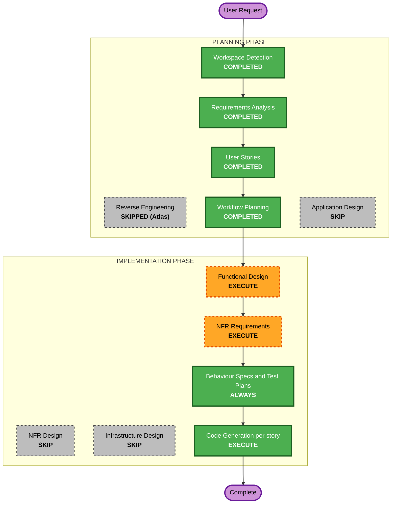

# Execution Plan

## Detailed Analysis Summary

### Transformation Scope
- **Transformation Type**: Single component set (existing FastAPI app + existing React Billing page); no architectural change
- **Primary Changes**: new `POST /api/billing/upgrade` plus proration helper in `src/backend/main.py`; upgrade button, modal and state update in `src/frontend/src/pages/Billing.jsx`; styles in `src/frontend/src/App.css`
- **Related Components**: `AuthContext.jsx` (token source, read only); no infrastructure, CDK or shared-library changes

### Change Impact Assessment
- **User-facing changes**: Yes - button, modal, success message on the Billing page
- **Structural changes**: No
- **Data model changes**: No schema; in-memory `users` and `billing_data` dict entries are mutated (plan, price, usage payload)
- **API changes**: Yes - one new endpoint, additive; existing endpoints unchanged
- **NFR impact**: Yes - Security Baseline (blocking), test tooling and coverage, property-based testing

### Component Relationships
- **Primary**: `src/backend/main.py`, `src/frontend/src/pages/Billing.jsx`
- **Supporting**: `src/frontend/src/App.css`, `src/frontend/src/context/AuthContext.jsx`
- **Dependent**: none (the Billing page is the only consumer of `/api/billing`)

### Risk Assessment
- **Risk Level**: Low (isolated, in-memory, additive; easy rollback)
- **Rollback Complexity**: Easy
- **Testing Complexity**: Moderate (first tests in the repo: pytest, Hypothesis, Playwright)

## Workflow Visualization

Text alternative: Workspace Detection, Requirements Analysis, User Stories, Workflow Planning, then Functional Design, NFR Requirements, Behaviour Specs and Test Plans, STOP, then per-story Code Generation. Skipped: Reverse Engineering, Application Design, NFR Design, Infrastructure Design.

## Phases to Execute

### PLANNING PHASE
- [x] Workspace Detection (COMPLETED)
- [x] Reverse Engineering (SKIPPED - Atlas deep dive pulled)
- [x] Requirements Analysis (COMPLETED)
- [x] User Stories (COMPLETED)
- [x] Execution Plan (COMPLETED)
- [ ] Application Design - SKIP
  - **Rationale**: no new components or services; the change lives inside existing component boundaries

### IMPLEMENTATION PHASE
- [ ] Functional Design - EXECUTE
  - **Rationale**: proration business rule and the upgrade state transition need a detailed design, and the property-based testing extension (enforced in full) requires a Testable Properties section (PBT-01)
- [ ] NFR Requirements - EXECUTE (minimal depth)
  - **Rationale**: Security Baseline is blocking and the repo has no test tooling; captures validation, error handling, test frameworks and coverage thresholds
- [ ] NFR Design - SKIP
  - **Rationale**: the only patterns needed (request validation, global exception handler) are captured in NFR Requirements; no scalability or resilience patterns apply (resiliency off)
- [ ] Infrastructure Design - SKIP
  - **Rationale**: no infrastructure change (local in-memory app, no deployment resources)
- [ ] Behaviour Specs and Test Plans - EXECUTE (ALWAYS, at the STOP CHECKPOINT, ONE approval)
- [ ] Code Generation - EXECUTE (ALWAYS, per story via `dev-implement`)

### Verification Engineer TRACK (parallel, not scheduled here)
- Test plans are written at the STOP CHECKPOINT; the Verification Engineer executes them once each story PR merges and signs off with `ve-list-work`.

## Success Criteria
- **Primary Goal**: Standard subscribers upgrade to Premium from the Billing page with a prorated charge preview and no reload
- **Key Deliverables**: upgrade endpoint, button, modal, state update, tests (pytest, Hypothesis, Playwright)
- **Quality Gates**: Security Baseline, unit coverage threshold, property tests, Playwright E2E, J1/J2 judge gates
